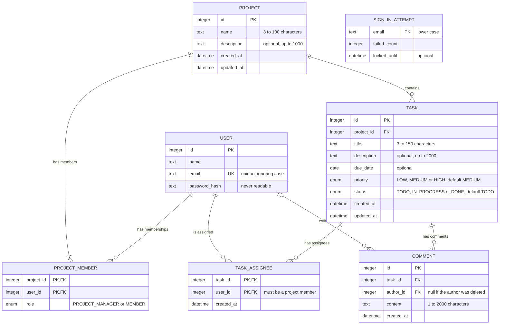

# Matriz: Data Model

> **Status: approved.** Conceptual model for the MVP, stored in PostgreSQL ([ADR 0002](decisions/0002-use-postgresql.md)). The schema is created with Liquibase ([architecture.md, section 5](architecture.md#5-technologies-and-hosting)).

## 1. Overview

```
USER ──< PROJECT_MEMBER >── PROJECT ──< TASK ──< COMMENT >── USER (author, 0..1)
  │                                       │
  └──────────< TASK_ASSIGNEE >────────────┘
```

- A user can be a member of many projects, and a project has many members (through PROJECT_MEMBER).
- A project has many tasks. Each task belongs to one project.
- A task can have many assignees, and a user can be assigned to many tasks (through TASK_ASSIGNEE). Each assignee must be a member of the project.
- A task has many comments. Each comment has one author, or none if the author's account was deleted.

## 2. ER diagram

Types are conceptual. Identifiers are integers, generated by the database.



| Relationship | Cardinality | Meaning |
|---|---|---|
| USER → PROJECT_MEMBER | 1 : 0..N | A user can belong to no projects or many. |
| PROJECT → PROJECT_MEMBER | 1 : 1..N | A project always has at least its project manager. |
| PROJECT → TASK | 1 : 0..N | Every task belongs to exactly one project. |
| TASK → TASK_ASSIGNEE | 1 : 0..N | A task can have no assignees or many. |
| USER → TASK_ASSIGNEE | 1 : 0..N | A user can be assigned to no tasks or many. |
| TASK → COMMENT | 1 : 0..N | Every comment belongs to exactly one task. |
| USER → COMMENT | 0..1 : 0..N | A comment has one author, or none after the author's account is deleted. |

The diagram can't show every rule. An assignee must be a member of the task's project, and each project has exactly one project manager. These rules are listed in [section 4](#4-rules).

## 3. Entities

### USER: a person with an account (FR-01)

| Attribute | Type | Rules |
|---|---|---|
| id | Integer | Primary key |
| name | Text | Required |
| email | Text | Required, unique (ignoring case) |
| password_hash | Text | Required, never stored or returned in readable form |

### PROJECT: groups the team's tasks (FR-02)

| Attribute | Type | Rules |
|---|---|---|
| id | Integer | Primary key |
| name | Text | Required, 3 to 100 characters after trimming, not only spaces |
| description | Text | Optional, up to 1000 characters |
| created_at | Date and time | Required, set when the project is created |
| updated_at | Date and time | Required, set when the project is created or changed |

### PROJECT_MEMBER: links users to projects (FR-03)

| Attribute | Type | Rules |
|---|---|---|
| project_id | Integer | Part of the primary key, references PROJECT |
| user_id | Integer | Part of the primary key, references USER |
| role | PROJECT_MANAGER or MEMBER | Required. Exactly one PROJECT_MANAGER per project |

### TASK: a unit of work in a project (FR-04, FR-05)

| Attribute | Type | Rules |
|---|---|---|
| id | Integer | Primary key |
| project_id | Integer | Required, references PROJECT |
| title | Text | Required, 3 to 150 characters after trimming, not only spaces |
| description | Text | Optional, up to 2000 characters |
| due_date | Date | Optional |
| priority | LOW, MEDIUM or HIGH | Required, default MEDIUM |
| status | TODO, IN_PROGRESS or DONE | Required, default TODO |
| created_at | Date and time | Required, set when the task is created |
| updated_at | Date and time | Required, set when the task is created or changed |

**"Late" is not stored.** A task is late when its due date is before today (in the user's local date) and its status isn't DONE (FR-08). It is worked out when needed, so it's never out of date. The server's local date is used: the application runs on the user's machine ([ADR 0006](decisions/0006-run-locally.md)), so it is the user's local date.

**Task counts per status are not stored.** They are counted from TASK when needed, over all of a project's tasks (FR-17).

### TASK_ASSIGNEE: links users to the tasks they're assigned to (FR-15)

| Attribute | Type | Rules |
|---|---|---|
| task_id | Integer | Part of the primary key, references TASK |
| user_id | Integer | Part of the primary key, references USER. Must be a member of the task's project |
| created_at | Date and time | Required, set when the assignment is made |

The primary key ensures a user is assigned to a task at most once (EC-08).

### COMMENT: a message about a task (FR-09)

| Attribute | Type | Rules |
|---|---|---|
| id | Integer | Primary key |
| task_id | Integer | Required, references TASK |
| author_id | Integer | References USER. Set from the session when the comment is created. Null after the author's account is deleted |
| content | Text | Required, 1 to 2000 characters, not only spaces |
| created_at | Date and time | Required, set by the server when the comment is created |

### SIGN_IN_ATTEMPT: failed sign-ins per account email (NFR-02)

| Attribute | Type | Rules |
|---|---|---|
| email | Text | Primary key, stored in lower case |
| failed_count | Integer | Required, number of failed attempts in a row |
| locked_until | Date and time | Optional. Set for 15 minutes after the 5th failed attempt |

Only emails of existing accounts are stored. A row is deleted after a successful sign-in, and when the account with that email is deleted.

## 4. Rules

**Projects and members**
- "Project manager" is a role in each project, not a type of account. A user can manage one project and be a member of another.
- The user who creates a project is its project manager. This can't be removed or changed (EC-07).
- Only the project manager can edit or delete the project, manage members and delete tasks (US-02, US-03, US-04).
- A user is a member of a project at most once.
- Removing a member removes their assignments in that project (US-03).
- Deleting a project deletes its tasks, their assignments and comments, and its memberships (US-02).

**Tasks, assignees and comments**
- Any project member can assign and unassign project members, and comment (US-10, US-11).
- A user is assigned to a task at most once (EC-08), and only if they are a member of the task's project (EC-09).
- Deleting a task deletes its assignments and comments (US-04).
- Comments can't be edited or deleted in the MVP.

**Accounts**
- An email can only be used by one account, ignoring case (EC-01).
- A project manager can't delete their account until they delete their projects (EC-06).
- Deleting an account deletes the user, their memberships, their assignments and their failed sign-in record, and sets the author of their comments to null (US-09). The email can then be used by a new account.

## 5. Sessions

Sessions are stored in PostgreSQL using Spring Session with JDBC ([ADR 0005](decisions/0005-use-spring-boot-and-angular.md)). Its tables are created by Liquibase and are separate from the application tables above. Failed sign-in attempts are stored in SIGN_IN_ATTEMPT, not by Spring Session.

There are no remaining open points for the MVP data model.

## 6. Notes

- **Privacy:** personal data (name and email) is only stored in USER and SIGN_IN_ATTEMPT, so deleting the account removes it (FR-14). Comments are kept without an author.
- **Security:** projects, tasks, assignments and comments are always filtered by PROJECT_MEMBER, so users only see their own projects (NFR-02, EC-04).
- **Integrity:** the database ensures there is at most one project manager per project, and at most one assignment per task and user; the application ensures there is always one project manager, and that assignees are project members.
