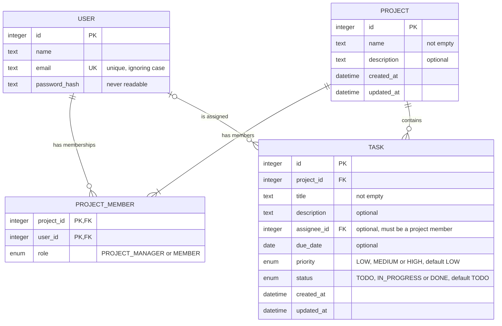

# Matriz: Data Model

> **Status: approved.** Conceptual model for the MVP, stored in PostgreSQL ([ADR 0002](decisions/0002-use-postgresql.md)).

## 1. Overview

```
USER ──< PROJECT_MEMBER >── PROJECT ──< TASK
  │                                       │
  └──────────── assignee (0..1) ──────────┘
```

- A user can be a member of many projects, and a project has many members (through PROJECT_MEMBER).
- A project has many tasks. Each task belongs to one project.
- A task has at most one assignee, who must be a member of the project.

Comments (FR-09) and several assignees per task are not part of the MVP, so they aren't modelled.

## 2. ER diagram

Types are conceptual. Identifiers are integers, generated by the database.



| Relationship | Cardinality | Meaning |
|---|---|---|
| USER → PROJECT_MEMBER | 1 : 0..N | A user can belong to no projects or many. |
| PROJECT → PROJECT_MEMBER | 1 : 1..N | A project always has at least its project manager. |
| PROJECT → TASK | 1 : 0..N | Every task belongs to exactly one project. |
| USER → TASK | 0..1 : 0..N | A task has zero or one assignee. |

The diagram can't show every rule. The assignee must be a member of the task's project, and each project has exactly one project manager. These rules are listed in [section 4](#4-rules).

## 3. Entities

### USER: a person with an account (FR-01)

| Attribute | Type | Rules |
|---|---|---|
| id | Integer | Primary key |
| name | Text | Required |
| email | Text | Required, unique (ignoring case) |
| password_hash | Text | Required, never stored or returned in readable form |

### PROJECT: groups the team's tasks (FR-02)

| Attribute | Type | Rules |
|---|---|---|
| id | Integer | Primary key |
| name | Text | Required, not empty |
| description | Text | Optional |
| created_at | Date and time | Required, set when the project is created |
| updated_at | Date and time | Required, set when the project is created or changed |

### PROJECT_MEMBER: links users to projects (FR-03)

| Attribute | Type | Rules |
|---|---|---|
| project_id | Integer | Part of the primary key, references PROJECT |
| user_id | Integer | Part of the primary key, references USER |
| role | PROJECT_MANAGER or MEMBER | Required. Exactly one PROJECT_MANAGER per project |

### TASK: a unit of work in a project (FR-04, FR-05)

| Attribute | Type | Rules |
|---|---|---|
| id | Integer | Primary key |
| project_id | Integer | Required, references PROJECT |
| title | Text | Required, not empty |
| description | Text | Optional |
| assignee_id | Integer | Optional, references USER. Must be a member of the project |
| due_date | Date | Optional |
| priority | LOW, MEDIUM or HIGH | Required, default LOW |
| status | TODO, IN_PROGRESS or DONE | Required, default TODO |
| created_at | Date and time | Required, set when the task is created |
| updated_at | Date and time | Required, set when the task is created or changed |

**"Late" is not stored.** A task is late when its due date is before today (in the user's local date) and its status isn't DONE (FR-08). It is worked out when needed, so it's never out of date. The server's local date is used: the application runs on the user's machine ([ADR 0006](decisions/0006-run-locally.md)), so it is the user's local date.

## 4. Rules

**Projects and members**
- "Project manager" is a role in each project, not a type of account. A user can manage one project and be a member of another.
- The user who creates a project is its project manager. This can't be removed or changed (EC-07).
- Only the project manager can edit or delete the project, manage members and delete tasks (US-02, US-03, US-04).
- A user is a member of a project at most once.
- Removing a member unassigns their tasks in that project (US-03).
- Deleting a project deletes its tasks and memberships (US-02).

**Accounts**
- An email can only be used by one account, ignoring case (EC-01).
- A project manager can't delete their account until they delete their projects (EC-06).
- Deleting an account deletes the user and their memberships, and unassigns their tasks (US-09). The email can then be used to sign up again.

## 5. Open points

- **Resolved:** sessions and failed sign-in attempts are stored in PostgreSQL using Spring Session with JDBC ([ADR 0005](decisions/0005-use-spring-boot-and-angular.md)). The schema is managed by Spring Session and is separate from the application tables above.

There are no remaining open points for the MVP data model.

## 6. Notes

- **Privacy:** personal data (name and email) is only stored in USER, so deleting one row removes it (FR-14).
- **Security:** projects and tasks are always filtered by PROJECT_MEMBER, so users only see their own projects (NFR-02, EC-04).
- **Integrity:** the database ensures there is at most one project manager per project; the application ensures there is always one.
